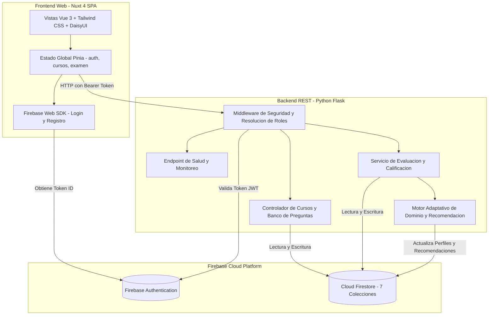
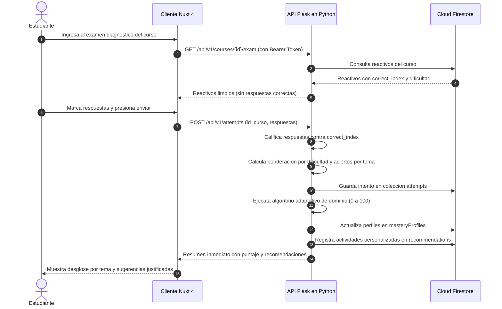

# Arquitectura del Sistema: AulaMentor AI

Documento de diseno arquitectonico, flujo de datos y backlog de historias de usuario para el Proyecto 02 de Lenguajes Modernos de Programacion.

---

## 1. Diagrama de Componentes y Capas

---

## 2. Flujo de Datos del Diagnostico y Recomendacion

---

## 3. Descripcion de Capas

### 3.1 Capa de Presentacion (apps/web)
Construida con Nuxt 4 configurado en modo cliente (SPA con renderizado en el navegador). Maneja el ciclo de vida de la sesion del usuario mediante Pinia, interactua directamente con Firebase Authentication para el alta e inicio de sesion, y se comunica con la API de Python adjuntando en cada cabecera HTTP el token ID en formato Bearer.

### 3.2 Capa de Negocio y Servicios (apps/api)
Implementada en Python con Flask. Se encarga de verificar la autenticidad del token en cada solicitud protegida, validar la estructura de los datos de entrada con Pydantic, ejecutar la calificacion automatica sin exponer las soluciones antes de tiempo, y alimentar el motor adaptativo de recomendacion.

### 3.3 Capa de Datos y Persistencia (Cloud Firestore)
Mantiene siete colecciones independientes conectadas mediante identificadores consistentes. Cuenta con reglas de acceso a nivel de base de datos (`firestore.rules`) que garantizan que ningun estudiante pueda modificar reactivos o calificaciones ajenas.

---

## 4. Backlog de Historias de Usuario (Fase 1 y Fase 2)

### HU-01: Inicio de Sesion y Asignacion de Rol
- **Como** usuario nuevo (docente o estudiante),
- **quiero** registrarme e iniciar sesion con mi correo institucional y contrasena,
- **para** ingresar al entorno de trabajo correspondiente a mis permisos.
- **Criterios de aceptacion:** El sistema valida el formato del correo, registra las credenciales en Firebase Auth, crea un documento vinculado en la coleccion `users` de Firestore y redirige a la vista adecuada segun el rol asignado.

### HU-02: Alta de Cursos por el Docente
- **Como** docente registrado,
- **quiero** dar de alta cursos con su codigo, titulo, descripcion y lista de unidades tematicas,
- **para** organizar los contenidos academicos que evaluare a lo largo del periodo.
- **Criterios de aceptacion:** Solo usuarios con rol `teacher` o `admin` pueden invocar el endpoint de creacion. La informacion se valida en el backend y se almacena en la coleccion `courses`.

### HU-03: Gestion del Banco de Preguntas Ponderadas
- **Como** profesor responsable de un curso,
- **quiero** cargar reactivos de opcion multiple indicando su unidad tematica, nivel de dificultad (1 basico, 2 intermedio, 3 avanzado) y la actividad de refuerzo vinculada,
- **para** alimentar la evaluacion diagnostica del curso.
- **Criterios de aceptacion:** Cada pregunta debe contener cuatro opciones y el indice de la respuesta correcta. La respuesta correcta nunca se envia en las consultas abiertas a estudiantes.

### HU-04: Inscripcion de Estudiantes al Curso
- **Como** alumno activo,
- **quiero** inscribirme a un curso mediante su catalogo o codigo de acceso,
- **para** quedar habilitado para presentar las evaluaciones de dicha materia.
- **Criterios de aceptacion:** Se genera un registro unico en la coleccion `enrollments` con estado `enrolled`. El backend rechaza intentos de inscripcion duplicados.

### HU-05: Resolucion de Evaluacion Diagnostica Segura
- **Como** estudiante inscrito,
- **quiero** contestar el diagnostico interactivo en linea y enviar mis respuestas,
- **para** conocer de inmediato mi desempeno conceptual sin intermediarios manuales.
- **Criterios de aceptacion:** El frontend recibe unicamente los enunciados y opciones. El servidor valida que el estudiante este inscrito, procesa la calificacion y guarda el intento en `attempts` con fecha e identificador de alumno.

### HU-06: Generacion de Recomendaciones Adaptativas Explicables
- **Como** estudiante que completo una evaluacion,
- **quiero** recibir recomendaciones de refuerzo acompanadas del motivo matematico y conceptual de la asignacion,
- **para** saber exactamente en que temas falle y que pasos seguir para mejorar.
- **Criterios de aceptacion:** El sistema calcula el dominio por tema (0 a 100), clasifica al alumno en `requiere_refuerzo`, `en_progreso` o `dominado`, genera tareas de refuerzo en `recommendations` y almacena el texto justificativo de acuerdo a la dificultad y porcentaje de aciertos.
