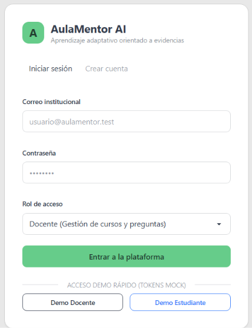
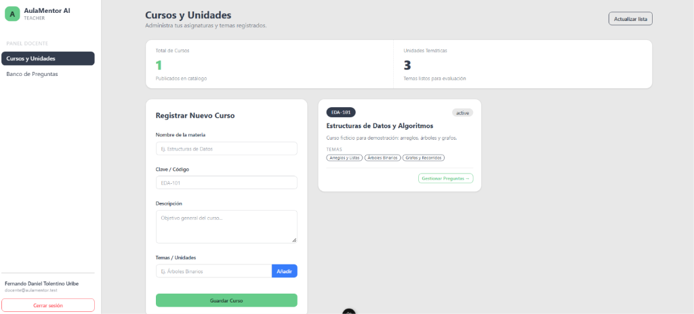
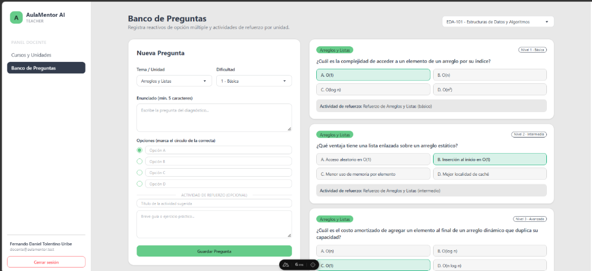
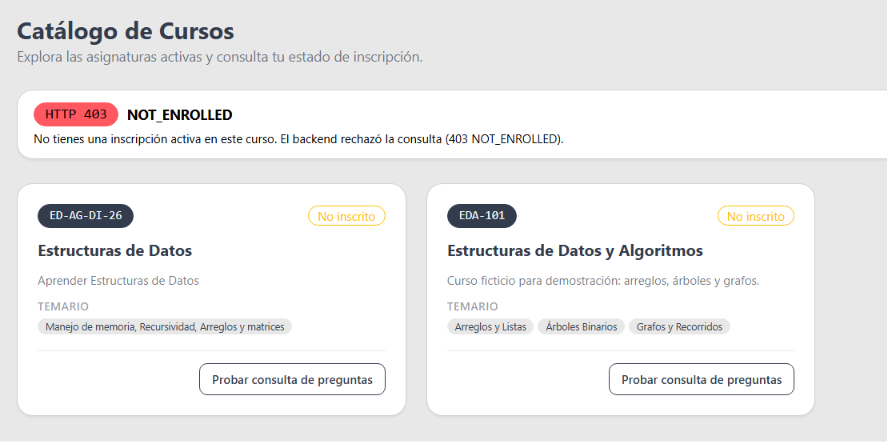
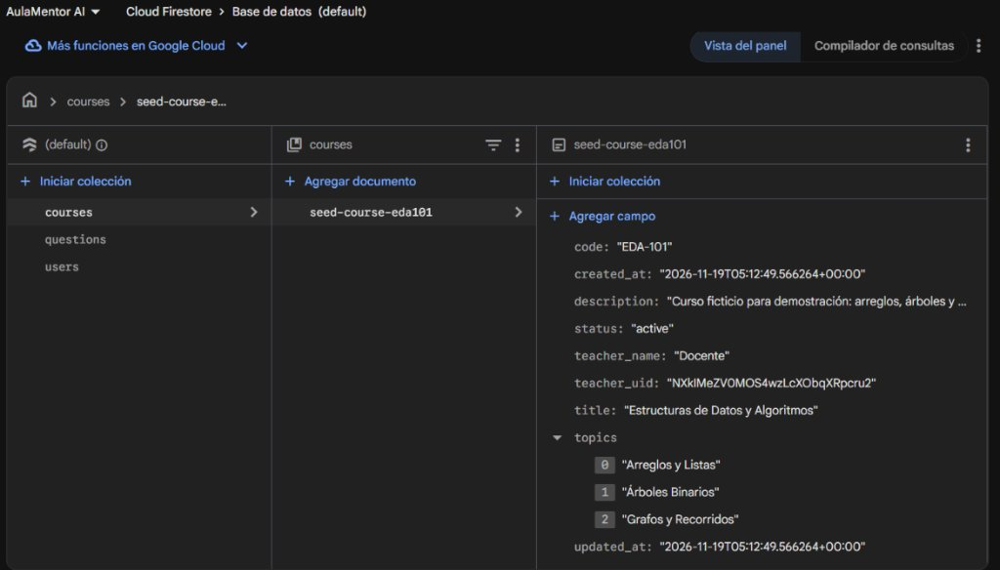
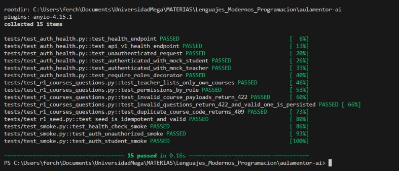

# Entrega Revisión 1 (R1) — AulaMentor AI

- **Proyecto:** Proyecto 02 — AulaMentor AI (Aprendizaje adaptativo orientado a evidencias)
- **Materia:** Lenguajes Modernos de Programación (Mtro. Marco Aurelio Ramírez Silva)
- **Fecha de entrega:** Jueves 19 de noviembre de 2026
- **Repositorio:** `https://github.com/ferchoesty-max/aulamentor-ai`
- **Etiqueta oficial (Tag):** `revision-1-2026-11-19`

---

## 1. Responsables y Trazabilidad de Pull Requests

| Integrante | Usuario GitHub | Rama / PR hacia `develop` | Aportación Principal en R1 |
|---|---|---|---|
| **Fernando Daniel Tolentino Uribe** | `@ferchoesty-max` | `feature/r1-auth-monorepo-setup` — [PR #1](https://github.com/ferchoesty-max/aulamentor-ai/pull/1) (`b6beae7`) | Estructura del monorepo, configuración raíz (`.env.example`, `.gitignore`, `firebase.json`, `netlify.toml`, `render.yaml`, `package.json`), conector Firebase Admin SDK (`apps/api/src/firebase/client.py`), middleware de autenticación JWT/Bearer y resolución de roles (`apps/api/src/auth/security.py`), manejador de errores (`ApiError`), repositorio base (`FirestoreRepository`), endpoints `/api/v1/health` y `/api/v1/auth/*`, `README.md`, `docs/architecture.md` (diagramas + 6 HU) y 9 pruebas base en `tests/`. |
| **María Paula** | `@Paula743` | `feature/r1-courses-questions-api` — [PR #2](https://github.com/ferchoesty-max/aulamentor-ai/pull/2) (`1c2a8db`) | Esquemas Pydantic (`CourseCreate`, `QuestionCreate`), validación `422` en español (`validation.py`), `MentorRepository` con consultas `.where()`, servicios y endpoints REST de cursos (`GET/POST /api/v1/courses`, `GET /api/v1/courses/<id>`) y preguntas (`GET/POST /api/v1/courses/<id>/questions`) ocultando `correct_index` a estudiantes, reglas e índices en `firebase/`, script idempotente `apps/api/scripts/seed_courses.py` y 6 pruebas nuevas (`test_r1_courses_questions.py`, `test_r1_seed.py`). |
| **Sebastián Puga (El Puga)** | `@Sheby400` | `feature/r1-ui-views-teacher-student` — [PR #3](https://github.com/ferchoesty-max/aulamentor-ai/pull/3) (`2a5d3ab`) | Configuración Nuxt 4 SPA + Tailwind CSS 4 + DaisyUI 5 + Pinia, plugin de Firebase Auth cliente (`firebase.client.ts`), store `useAuthStore`, helper HTTP `useApi.ts`, middleware de rutas por rol (`auth.global.ts`) y las 4 vistas navegables (`/login`, `/teacher/courses`, `/teacher/questions`, `/student/courses`) con manejo visual de falla controlada (`403 NOT_ENROLLED`). |

*Cierre e integración a `main`:* [PR #4](https://github.com/ferchoesty-max/aulamentor-ai/pull/4) (`042537d`: `docs/model.md`, `docs/revisiones/R1.md`, `README.md`, `.firebaserc`, emuladores y `load_dotenv()`) y [PR #5](https://github.com/ferchoesty-max/aulamentor-ai/pull/5) (`4a66175`: integración `develop` → `main`).

---

## 2. Checklist de Entregables R1 (Guía Oficial Págs. 3, 4, 6 y 15)

- [x] Repositorio único en GitHub con ramas `main`, `develop` y `feature/*` integradas vía Pull Requests revisados.
- [x] `README.md` con problema, objetivo, alcance MVP, roles, integrantes, tecnologías, comandos ejecutables y cuentas de prueba ficticias sin secretos.
- [x] Al menos 5 historias de usuario (6 HU documentadas), diagrama de componentes y flujo de datos en [docs/architecture.md](../architecture.md).
- [x] Modelo inicial de Cloud Firestore (7 colecciones) en [docs/model.md](../model.md) y reglas/índices en `firebase/`.
- [x] Diseño navegable de 4 vistas principales (`/login`, `/teacher/courses`, `/teacher/questions`, `/student/courses`).
- [x] Autenticación funcional con separación de roles (`teacher`, `student`, `admin`) y alta/consulta persistente de cursos y preguntas en Firestore.
- [x] Prueba satisfactoria y falla controlada verificables (`401 UNAUTHENTICATED`, `403 FORBIDDEN` / `403 NOT_ENROLLED`, `422 VALIDATION_ERROR`).
- [x] Suite automatizada ejecutada (`python -m pytest tests -v`: **15 pruebas aprobadas**), `npm run typecheck` y `npm run build:web` sin errores.

---

## 3. Verificación Técnica y Evidencias

### Pruebas y Compilación
- **Backend (`python -m pytest tests -v`):** 15/15 aprobadas (`test_auth_health.py`, `test_r1_courses_questions.py`, `test_r1_seed.py`, `test_smoke.py`).
- **Frontend (`npm run typecheck` / `npm run build:web`):** Validación TypeScript/Vue y generación estática en Nuxt 4 exitosas.
- **Persistencia real en Cloud Firestore (`aulamentor-ai-ferch`):** Reglas e índices desplegados, cuenta real autenticada con Firebase Auth y curso `EDA-101` + 9 preguntas guardados y consultados desde la nube.

### Capturas de Evidencia (`evidencias/`)

1. **Inicio de sesión y roles (`/login`):**
   
2. **Panel Docente — Cursos y Unidades (`/teacher/courses`):**
   
3. **Panel Docente — Banco de Preguntas (`/teacher/questions`):**
   
4. **Portal Estudiante y falla controlada `HTTP 403 NOT_ENROLLED` (`/student/courses`):**
   
5. **Cloud Firestore real (`aulamentor-ai-ferch`) con colecciones `users`, `courses` y `questions`:**
   
6. **Suite de pruebas automatizadas (`python -m pytest tests -v` — 15/15 aprobadas):**
   
