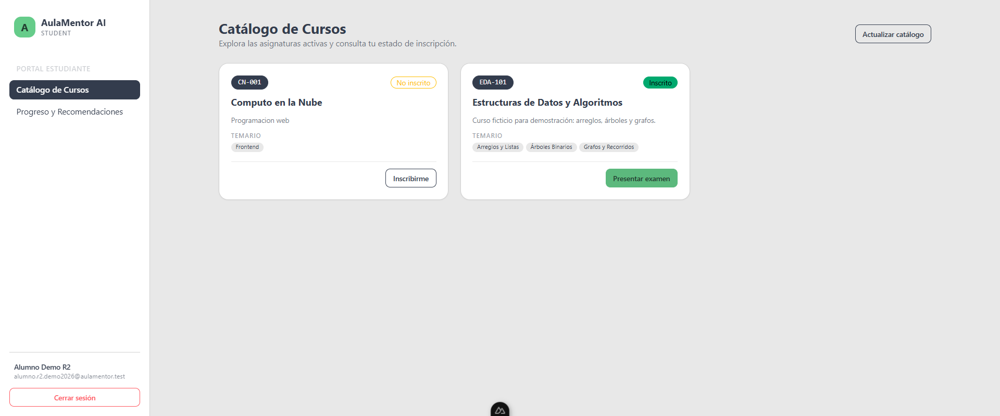
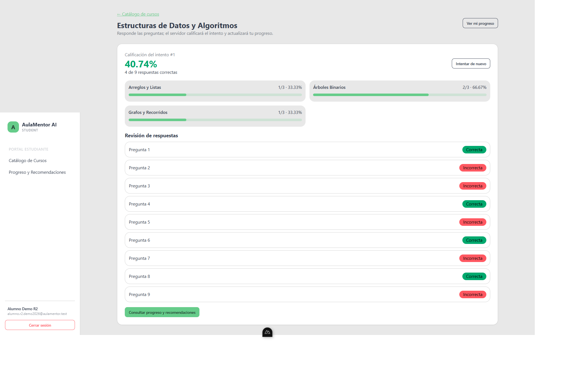
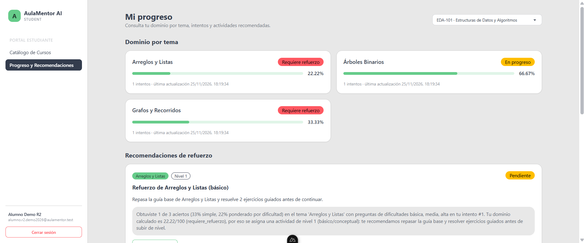
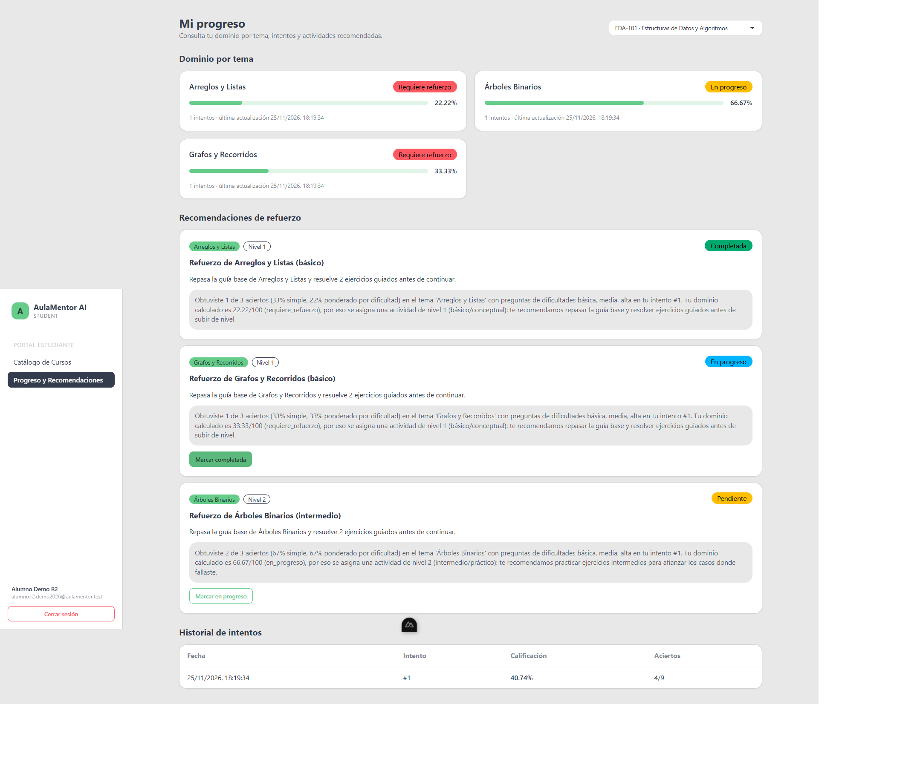

# Entrega Revisión 2 (R2) — AulaMentor AI

- **Proyecto:** Proyecto 02 — AulaMentor AI (Aprendizaje adaptativo orientado a evidencias)
- **Materia:** Lenguajes Modernos de Programación (Mtro. Marco Aurelio Ramírez Silva)
- **Fecha de entrega:** Jueves 26 de noviembre de 2026
- **Repositorio:** `https://github.com/ferchoesty-max/aulamentor-ai`
- **Etiqueta oficial (Tag):** `revision-2-2026-11-26`

---

## 1. Responsables y Trazabilidad de Pull Requests

| Integrante | Usuario GitHub | Rama / PR hacia `develop` | Aportación Principal en R2 |
|---|---|---|---|
| **Fernando Daniel Tolentino Uribe** | `@ferchoesty-max` | `feature/r2-adaptive-algorithm-mastery` — [PR #8](https://github.com/ferchoesty-max/aulamentor-ai/pull/8) (`a4c3632`) | Motor explicable de dominio por tema y recomendaciones (`apps/api/src/services/adaptive_service.py`), cálculo ponderado por dificultad (`1.0 / 1.5 / 2.0`) y consistencia por intentos (`70%` + `30%`), clasificación (`requiere_refuerzo`, `en_progreso`, `dominado`), endpoints `GET /api/v1/mastery/<course_id>`, `GET /api/v1/recommendations`, `PATCH /api/v1/recommendations/<id>/status` (`pending` → `in_progress` → `completed`) y 5 pruebas en `tests/test_r2_adaptive.py`. |
| **María Paula** | `@Paula743` | `feature/r2-enrollments-attempts-crud` — [PR #9](https://github.com/ferchoesty-max/aulamentor-ai/pull/9) (`dbd9226`) | CRUD completo con edición (`PATCH`) y baja lógica (`DELETE`) en cursos y preguntas, módulo de inscripciones (`POST /api/v1/enrollments`, `GET /api/v1/enrollments/my`, `GET /api/v1/courses/<id>/enrollments`), evaluación de intentos calificados en servidor (`POST /api/v1/attempts`, `GET /api/v1/attempts`, `grading.py`) con integración directa a `process_attempt_adaptation`, documentación en [docs/api.md](../api.md) y 6 pruebas en `tests/test_r2_enrollments_attemps.py`. |
| **Sebastián Puga (El Puga)** | `@Sheby400` | `feature/r2-ui-exam-progress-recommendations` — [PR #10](https://github.com/ferchoesty-max/aulamentor-ai/pull/10) (`d576ca2`) | Flujo de inscripción en `apps/web/app/pages/student/courses/index.vue`, pantalla interactiva de examen (`/student/courses/[id]/exam`) sin exposición de `correct_index`, vista de progreso y recomendaciones (`/student/progress`) con barras de dominio, historial de intentos y cambio de estado (`pending` → `in_progress` → `completed`), enlace en sidebar (`layouts/default.vue`) y guarda de rutas `/student` en `middleware/auth.global.ts`. |

*Cierre e integración de R2:* actualización de [firebase/firestore.rules](../../firebase/firestore.rules) para las 7 colecciones, especificación del algoritmo en [docs/model.md](../model.md) y este documento de entrega.

---

## 2. Checklist de Entregables R2 (Guía Oficial Págs. 6, 15 y Semiguía)

- [x] CRUD principal completo sobre cursos y preguntas (`POST`, `GET`, `PATCH`, `DELETE` con baja lógica).
- [x] Permisos efectivos por rol (`teacher`, `student`, `admin`) tanto en API Python como en guardas de Nuxt 4 y reglas de Firestore.
- [x] Flujo central completo con cambios de estado persistentes en Firestore: inscripción (`enrolled`) → examen (`attempts`) → calificación automática en servidor → actualización de dominio (`masteryProfiles`) → generación y avance de recomendaciones (`pending` → `in_progress` → `completed`).
- [x] Primera versión ejecutable del algoritmo adaptativo explicable sin IA comercial (`70%` aciertos ponderados + `30%` consistencia por intentos).
- [x] Documentación de endpoints REST en [docs/api.md](../api.md) y modelo + fórmula en [docs/model.md](../model.md).
- [x] Suite automatizada con más de 5 pruebas aprobadas (**26/26 aprobadas** con `python -m pytest tests -v`).
- [x] Capturas de evidencia del flujo completo R2 en `evidencias/` (`r2_01_catalogo_inscripcion.png` – `r2_04_recomendaciones_estado.png`).

---

## 3. Verificación Técnica

### Pruebas y Compilación
- **Backend (`python -m pytest tests -v`):** **26/26 aprobadas** (`test_auth_health.py`, `test_r1_courses_questions.py`, `test_r1_seed.py`, `test_r2_adaptive.py`, `test_r2_enrollments_attemps.py`, `test_smoke.py`).
- **Frontend (`npm run typecheck` y `npm run build:web`):** Verificación de tipos Vue/TypeScript (`vue-tsc --noEmit`) y compilación estática de Nuxt 4 (`apps/web/.output/public`) exitosas sin errores.
- **Prueba integral en vivo contra Cloud Firestore (`aulamentor-ai-ferch`):** Registro de estudiante (`alumno.r2.demo2026@aulamentor.test`), inscripción en `EDA-101`, envío de 9 respuestas con calificación ponderada en servidor (`40.74%`, `4/9`), cálculo de dominio por tema (`22.22%`, `66.67%`, `33.33%`) y avance de estados en recomendaciones (`Pendiente` → `En progreso` → `Completada`) sin errores de consola.

### Capturas de Evidencia (`evidencias/`)

1. **Catálogo e inscripción en curso activo (`/student/courses`):**
   
2. **Evaluación calificada en servidor y desglose por tema (`/student/courses/[id]/exam`):**
   
3. **Dominio por tema calculado por el algoritmo adaptativo (`/student/progress`):**
   
4. **Recomendaciones explicables, cambio de estado e historial de intentos (`/student/progress`):**
   
